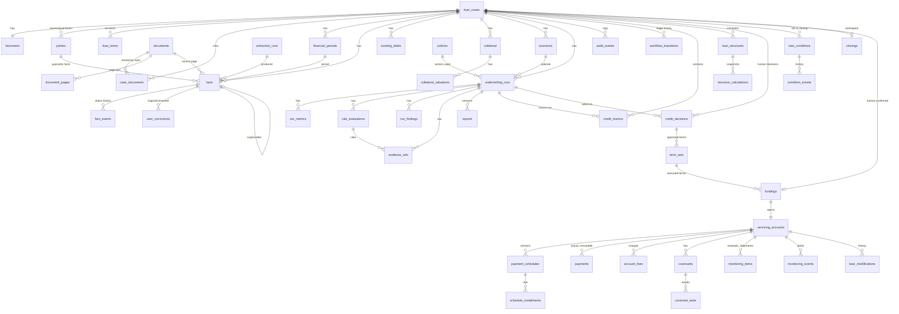

# Architecture and data model

## Principles enforced in code

| Principle | Where |
|---|---|
| LLM output is untrusted | `llm/extraction.py` saves only `candidate` facts; values must literally appear on the cited page or are discarded |
| Python is authoritative | `metrics/` (Decimal arithmetic), `policy/engine.py` |
| Missing stays missing | metrics return `not_computable`; rules return `UNKNOWN`; no zero-filling |
| No silent reconciliation | `analysis/resolver.py` marks disagreeing sources `conflict`; resolution needs a reason |
| History is never overwritten | DB triggers make facts' values, runs, policies and audit events immutable |
| Not a decision engine | overall status is INCOMPLETE / REVIEW_REQUIRED / NO_EXCEPTIONS_IDENTIFIED ("not an approval") |

## Layers

```
web (FastAPI + Jinja2, CSRF/Host/Origin middleware)
  └── analysis (resolver → module metrics → policy engine → run persistence) ─ reports
        ├── modules/commercial (field catalog, loan types, checklist)   ← extension point
        ├── metrics (finance math, commercial metrics)
        └── policy (schema, loader, engine)
  └── documents (storage, PyMuPDF, Tesseract) ── llm (Ollama client, extraction, narrative)
  └── repo (cases, facts, audit) ── db (connection, migrations)
```

### Adding a lending module
Implement `modules.base.LendingModule` (field catalog, metric catalog, `compute_metrics`, `required_items`,
`document_types`) and `register()` it in `modules/__init__.py`. Policies name their `module`; the loader
validates every metric, field, loan type and document type a policy references against that module.

## Entity relationships



Lifecycle tables (migrations 0002–0006) are described in [LIFECYCLE.md](LIFECYCLE.md) and [SERVICING.md](SERVICING.md).
Immutability triggers protect transitions, memos, decisions, term sets, structure inputs and calculations, condition
events, fundings, schedule installments, payments, covenant tests, modifications and audit events.

### Table notes
* **documents** are unique by `sha256`; `case_documents` lets one stored file serve several cases.
  Stored file name = hash, never the user's file name.
* **financial_periods**: `(case, period_end, period_months)`; `period_months = 0` = balance-sheet date.
* **facts** hold extracted, user-entered and user-corrected values with source, page, excerpt, model name+digest,
  model self-confidence and deterministic evidence checks. Value columns are protected by trigger
  `trg_facts_values_immutable`. `verified_facts` is a view.
* Verification status changes go to **fact_events**; corrections create a new fact + **user_corrections** row.
* **loan_terms** are revisioned (`is_current`), never edited in place.
* **underwriting_runs** store the full input snapshot (`inputs_json`, `inputs_sha256`), the policy version id and
  engine version; metrics, rule results, findings and evidence are child rows. Runs cannot be updated.
* **policies** store canonical JSON + SHA-256 for every version ever loaded; a changed file with an unchanged
  version is refused.
* Money/ratios are stored as TEXT decimal strings. All SQL is parameterised.

## Audit hash chain (migration 0006)
Each audit event stores `prev_hash` and `event_hash` (SHA-256 over the previous hash and the event's fields). Events
created before 0006 are hashed once at startup. When a case is purged, only the ids and hashes of its removed events
are kept in `audit_purged_hashes`, so the remaining chain stays verifiable. Funded loans cannot be purged from the app.

## Migration strategy
Forward-only numbered SQL files in `src/uwhelper/db/migrations/` applied at startup (`uwhelper init` or `serve`),
each in its own transaction, recorded with SHA-256 in `schema_migrations`. Editing an applied migration is
detected and refused — add `0002_*.sql` instead. Roll back by restoring a backup.
